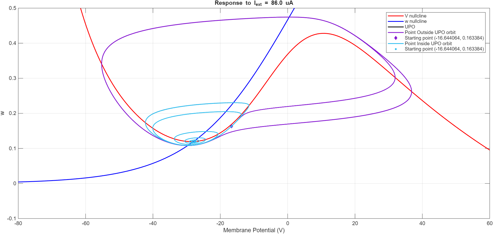
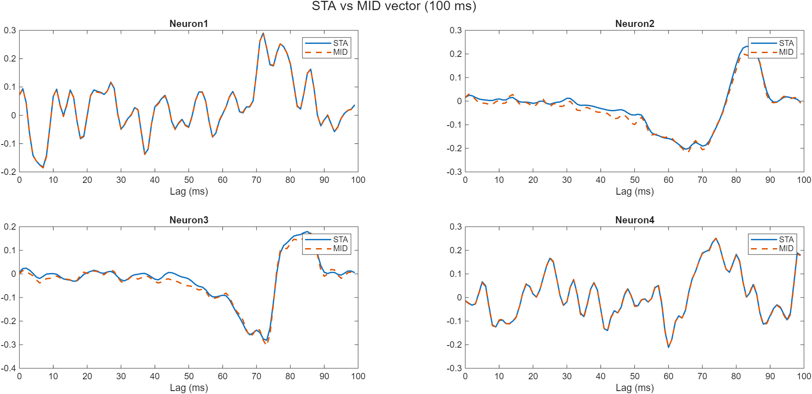
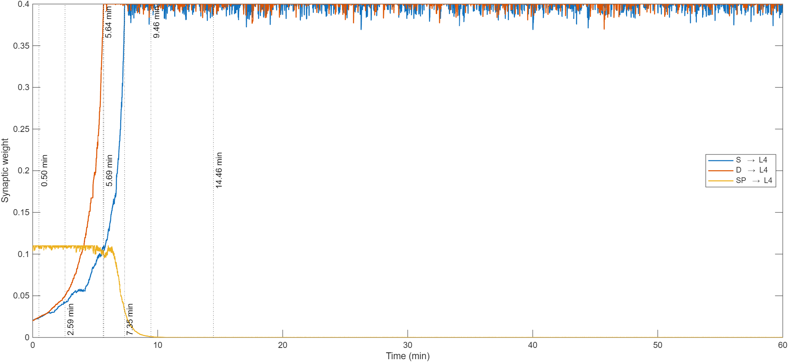

# Computational Neuroscience (EC60007): Course Projects

MATLAB implementations of the course projects for Computational Neuroscience (EC60007) at IIT Kharagpur, Autumn 2026. Each project is a single script that generates all of its figures, with a README that describes the model, the analysis and the results.

| Project | Topic | Preview |
| --- | --- | --- |
| [Project II](project-2-excitability/) | Excitability and bifurcation analysis of the Morris–Lecar and Hodgkin–Huxley models: phase planes, thresholds, unstable periodic orbits, SNIC and Hopf bifurcations, reduced models and anode-break excitation |  |
| [Project III](project-3-auditory-encoding/) | Encoding models of four auditory neurons: spike-triggered average with autocorrelation correction, output nonlinearity, filter pruning, and Maximally Informative Dimensions (one and two vectors) |  |
| [Project IV](project-4-adaptive-network/) | An adaptive thalamus–subplate–layer 4 spiking network with depressing synapses and STDP: oddball responses and the development of synaptic weights over an hour of stimulation |  |

## Repository layout

```
computational-neuroscience/
├── project-2-excitability/
├── project-3-auditory-encoding/
└── project-4-adaptive-network/
    ├── README.md
    ├── src/       # the MATLAB script
    └── results/   # figures exported from the script
```

## Running the code

Open the script of a project in MATLAB and run it. Each question is its own `%%` section, so sections can also be run one at a time. Project III needs the course data file `data_cn_project_iii_a26.mat`, which is not included here; place it next to the script. Project IV writes large `.mat` result files next to the script during its 60-minute simulations; these are excluded by `.gitignore`.

Course handouts and data files are not part of this repository.
