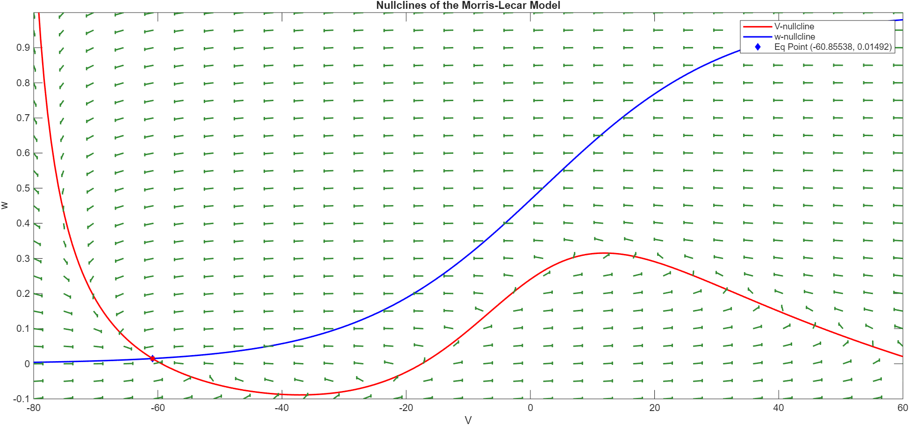
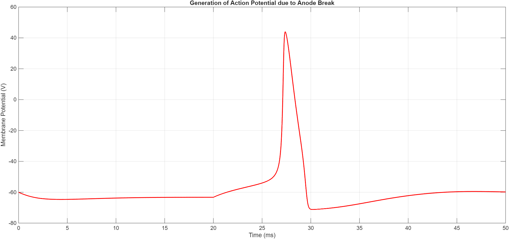
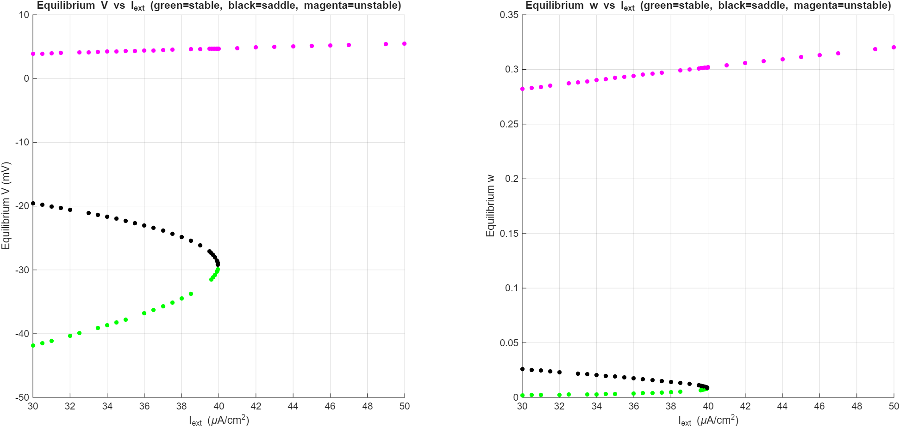
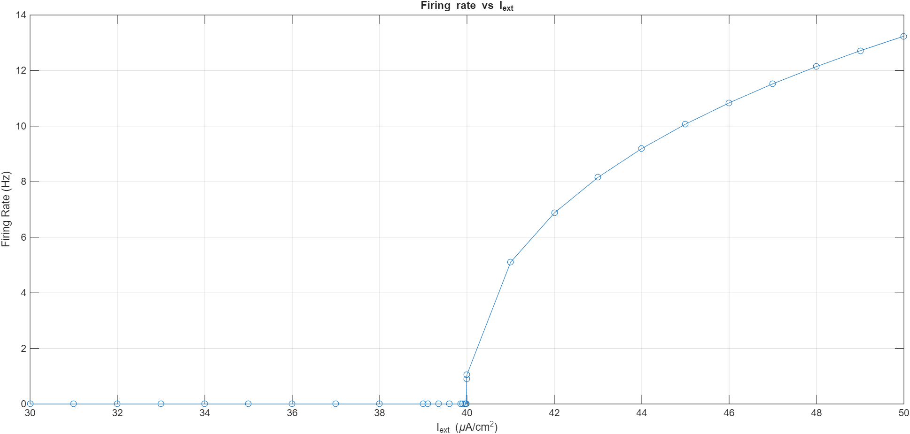
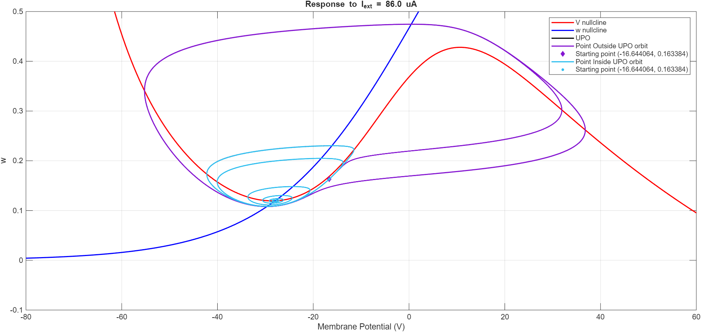

# Project II: Excitability, Bifurcations and Neuron Models (Morris–Lecar and Hodgkin–Huxley)

Course project for Computational Neuroscience (EC60007), IIT Kharagpur, Autumn 2026. Implemented in MATLAB.

The project studies how single-neuron models become excitable, using phase-plane and bifurcation analysis. Part I works with the two-variable **Morris–Lecar (ML)** model, in two parameter sets that give the two classic excitability types. Part II builds the four-variable **Hodgkin–Huxley (HH)** model, reduces it to two-variable systems, and uses these to explain **anode-break excitation**.



## What is in this folder

```
project-2-excitability/
├── src/project2_morris_lecar_hh.m    # single script, produces every figure
└── results/Figure_1.png ... Figure_25.png
```

Run `src/project2_morris_lecar_hh.m` in MATLAB. It runs from top to bottom (each question is its own `%%` section) and opens all 25 figures. The figures in `results/` were exported from this script.

## Models

**Morris–Lecar** (units: ms, mV, µA/cm², µF/cm², mS/cm²):

```
C·dV/dt = Iext − gL·(V − VL) − gCa·m∞(V)·(V − VCa) − gK·w·(V − VK)
dw/dt   = φ·(w∞(V) − w) / τw(V)

m∞(V) = ½·(1 + tanh((V − V1)/V2))
w∞(V) = ½·(1 + tanh((V − V3)/V4))
τw(V) = 1 / cosh((V − V3)/(2·V4))
```

Two parameter sets are used. The first is the Rinzel–Ermentrout (Chapter 7) set (`gCa = 4.4`, `φ = 0.02`, `V3 = 2`, `V4 = 30`), which gives **Class II** excitability. The second (`gCa = 4`, `φ = 0.0667`, `V3 = 12`, `V4 = 17.4`) has three equilibria for `Iext = 30` and gives **Class I** excitability.

**Hodgkin–Huxley** (squid giant axon): the standard `V, m, n, h` system with `C = 1 µF/cm²`, `gNa = 120`, `gK = 36`, `gL = 0.3 mS/cm²`, `ENa = 55 mV`, `EK = −72 mV`. The leak reversal potential `EL` is **solved analytically** so that the resting potential is exactly −60 mV. The `0/0` points of `αn` and `αm` are handled explicitly. Integration uses the stiff solver `ode15s` with `RelTol = 1e-12` and `AbsTol = 1e-15`.

## Questions and results

| Question | What the code does | Figures |
| --- | --- | --- |
| Q2–Q3 | Nullclines, direction field and the equilibrium point of ML found two ways, plus the Jacobian eigenvalues. The equilibrium is at `V ≈ −60.86 mV`, `w ≈ 0.0149`, with eigenvalues `−0.037` and `−0.096`, so it is a stable node. | 1 |
| Q5 | Action potential and phase-plane trajectory for `φ = 0.02` and larger/smaller `φ`. The slower the recovery variable, the more the trajectory follows the `V`-nullcline. | 2–5 |
| Q6 | Depolarizing pulses (initial `V` above rest, `Iext = 0`). Sweeping the initial voltage finely shows a sharp threshold in the peak voltage. | 6–9 |
| Q7–Q8 | Response to `Iext = 86 µA/cm²` from three initial conditions. The system is **bistable** (stable equilibrium plus a stable limit cycle). Running the model **backward in time** finds the unstable periodic orbit (UPO), which separates the two basins. An infinitesimal change in `V` across the UPO switches a subthreshold response into an action potential. | 10–12 |
| Q9 | Eigenvalues at `Iext = 80, 86, 90`. The real part changes sign between 86 and 90 µA/cm², as expected for a Hopf bifurcation. Firing rate vs. applied current over 80–100 µA/cm². | 13 |
| Q10 | Second parameter set at `Iext = 30`: three equilibria (a stable node, a saddle and an unstable focus), with nullclines and the stable/unstable manifolds of the saddle. | 14 |
| Q11 | Equilibria versus `Iext` from 30 to 50, with a fine sweep between 39 and 40 µA/cm² where the stable node and the saddle merge and disappear (a saddle-node on an invariant circle). Firing rate against current starts at zero rate, which is the Class I signature. | 15–16 |
| Q12–Q13 | HH simulation with `Iext = 10 µA/cm²`, the fitted `EL`, and the time courses of `m, n, h` over one action potential. | 17–18 |
| Q14 | Stability at rest and the brief-pulse threshold, found with a very fine sweep of the initial voltage. Threshold ≈ −53.4924 mV. | 19 |
| Q15 | Equilibria of HH against steady current from 8 to 12 µA/cm². | 20 |
| Q16 | Reduced `(V, n)` model, with `m` and `h` held at their steady-state and resting values. | 21 |
| Q17 | **Anode-break excitation**: a −3 µA/cm² pulse lasting 20 ms is followed by a spike once the pulse ends. | 22 |
| Q18 | Reduced `(V, m)` phase planes with `n` and `h` fixed at their resting values and at their values at the end of the anodal pulse. In the second case the resting equilibrium disappears, which is why the membrane fires when the pulse ends. | 23–25 |

### Anode-break excitation



### Class I excitability: equilibria and firing rate





### Threshold as an unstable periodic orbit



## Notes

- The write-up and the assignment handout are not part of this repository.
- The script sets `warning('off', 'all')` at the top to keep the console clean during the long sweeps.
