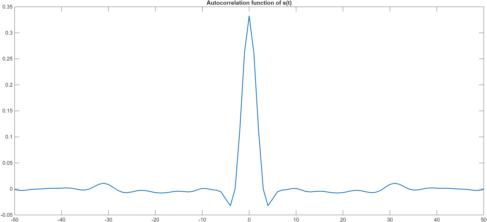
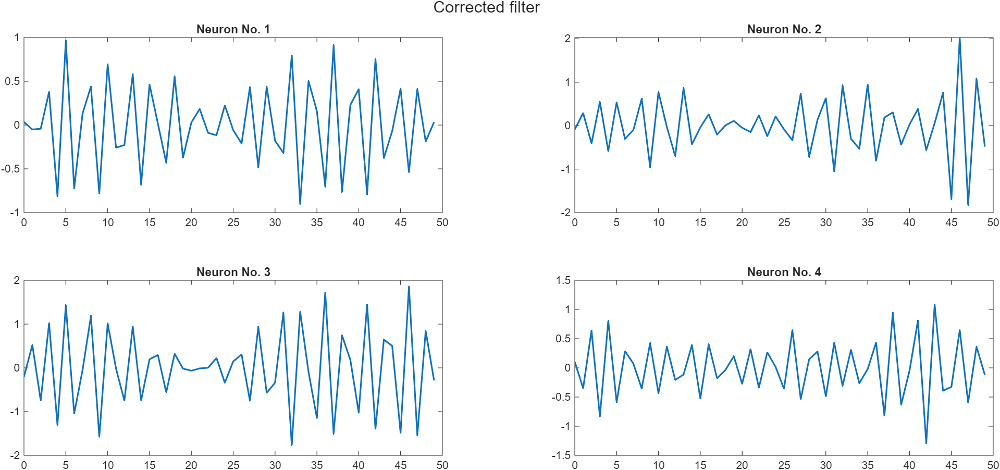
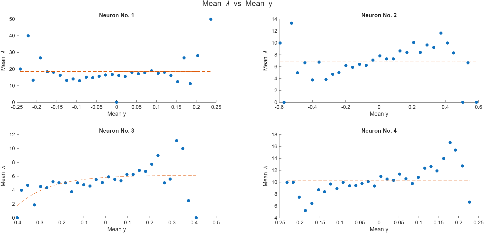
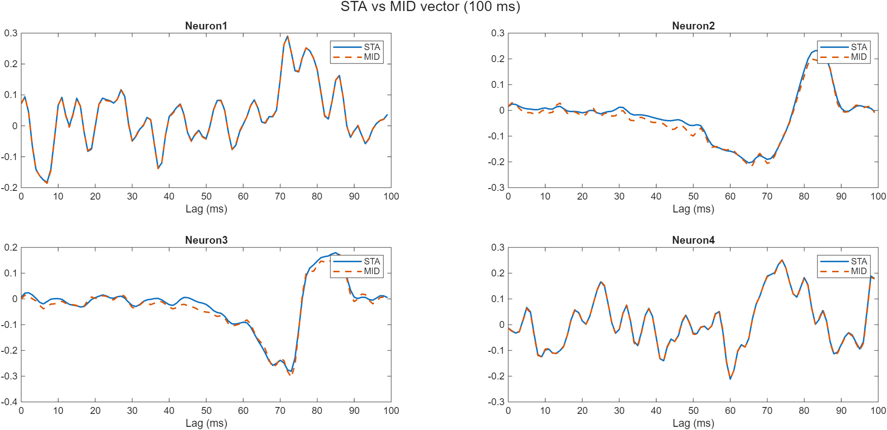
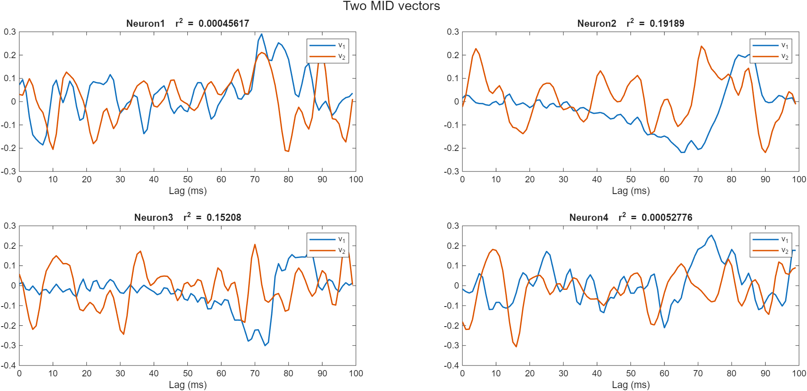

# Project III: Encoding Models of Auditory Neurons (STA, Output Nonlinearity and Maximally Informative Dimensions)

Course project for Computational Neuroscience (EC60007), IIT Kharagpur, Autumn 2026. Implemented in MATLAB.

The goal is to find which features of a sound envelope each of four auditory neurons responds to. The data are spike times from four neurons, recorded simultaneously, in response to the same 20 s stimulus repeated 50 times. The stimulus is the envelope (in dB) of a broadband noise carrier, sampled at 1 kHz. The first 15 s are used to estimate each model and the last 5 s to test its predictions.



## What is in this folder

```
project-3-auditory-encoding/
├── src/project3_encoding.m           # single script, produces every figure
└── results/Figure_1.png ... Figure_24.png (Figure_3 not included)
```

**The data file is not included.** The script starts with `load('data_cn_project_iii_a26.mat')`, a file provided with the course that contains `All_Spike_Times` (a 4 × 50 cell array of spike times in seconds) and `Stimulus` (20000 samples, in dB). To run the script, place that file in the same folder as the script.

## Pipeline

1. **Stimulus statistics.** The stimulus autocorrelation is computed (with `xcorr` and from scratch). It is not white: it has clear short-range correlations, so a plain spike-triggered average would be biased and needs a correction.
2. **PSTH.** Firing rate in 1 ms bins over the 50 repeats for each neuron (rates of tens of spikes/s, up to about 100).
3. **Poisson or not?** Spike-count mean-versus-variance scatter plots at six bin sizes (10, 20, 50, 100, 200 and 500 ms), interspike-interval histograms and the CV of the ISIs. The ISI distributions are close to exponential and the CV is about 1 for all four neurons.
4. **Spike-triggered average (STA)**, with a 50 ms filter. The raw STA is corrected for the stimulus autocorrelation by solving `C_ss · h = STA`, with `C_ss` the Toeplitz autocorrelation matrix of the stimulus.
5. **Output nonlinearity.** The filter output `y(t)` is plotted against the measured rate, both as a raw scatter and as the mean rate over binned `y`, to estimate a static (sigmoidal) nonlinearity `f(y)`.
6. **Prediction and pruning.** The model predicts the PSTH of the held-out last 5 s, quantified by `r²` (the squared correlation between predicted and measured rate). Filter coefficients are then set to zero one at a time, smallest magnitude first, as long as `r²` does not drop significantly. The magnitude of the FFT of the final filters shows their frequency response.
7. **Track A: Maximally Informative Dimensions (MID).** Starting from the STA, the filter is updated to maximize the information between the spike train and the projection of 100 ms stimulus segments. Local optima are checked using random restarts. A second filter, initialized orthogonal to the first, gives a two-dimensional MID model with a product-of-sigmoids nonlinearity, and a time-shifted spike train serves as a shuffled control.

## Results

`r²` on the held-out 5 s, and information (bits per spike) captured by the MID filters:

| Neuron | `r²` STA | `r²` MID (1 vector) | `r²` MID (2 vectors) | MI 1D | MI 2D | MI 2D (shuffled control) |
| --- | --- | --- | --- | --- | --- | --- |
| 1 | 0.000 | 0.000 | 0.000 | 0.0046 | 0.021 | 0.013 |
| 2 | 0.190 | 0.190 | 0.192 | 0.4216 | 0.437 | 0.032 |
| 3 | 0.161 | 0.164 | 0.152 | 0.4008 | 0.445 | 0.040 |
| 4 | 0.000 | 0.000 | 0.001 | 0.0102 | 0.036 | 0.022 |

- **Neurons 2 and 3** carry information about the stimulus envelope: their MID information is about 0.4 bits per spike, roughly ten times or more the shuffled control, and the 1D MID filter is very close to the STA. Prediction is modest (`r²` of about 0.16 to 0.19), and neither the second MID vector nor pruning improves it much.
- **Neurons 1 and 4** are not captured by these models: `r²` is about zero for all methods and their information is at the level of the shuffled control.
- The corrected STA filters of all four neurons are strongly oscillatory over the 50 ms window (Figure 12), and their frequency responses are shown in Figure 18.

### Corrected filters and static nonlinearity





### MID versus STA





## Figure index

| Figure | Content |
| --- | --- |
| 1 | The stimulus |
| 2 | Autocorrelation of the stimulus (built-in `xcorr`; the from-scratch version, Figure 3, is not included) |
| 4 | PSTHs of the four neurons |
| 5–8 | Spike-count mean versus variance at six bin sizes, one figure per neuron |
| 9 | ISI histograms |
| 10 | CV of the ISIs |
| 11 | Raw STA |
| 12 | Corrected filters |
| 13 | Measured rate vs. estimated `y(t)` (scatter) |
| 14 | Mean rate vs. mean `y` (binned nonlinearity) |
| 15 | Predicted vs. actual rate on the held-out 5 s |
| 16 | Prediction performance vs. number of non-zero filter parameters |
| 17 | Pruned filters |
| 18 | Frequency response of the pruned filters |
| 19 | MID: mutual information per epoch |
| 20 | STA vs. MID vector (100 ms) |
| 21 | Information at the STA start, the MID optimum and random restarts |
| 22 | MID prediction (1 vector) |
| 23 | MID: prediction vs. number of parameters |
| 24 | Two MID vectors |

## Notes

- The assignment handout and the course data file are not part of this repository.
