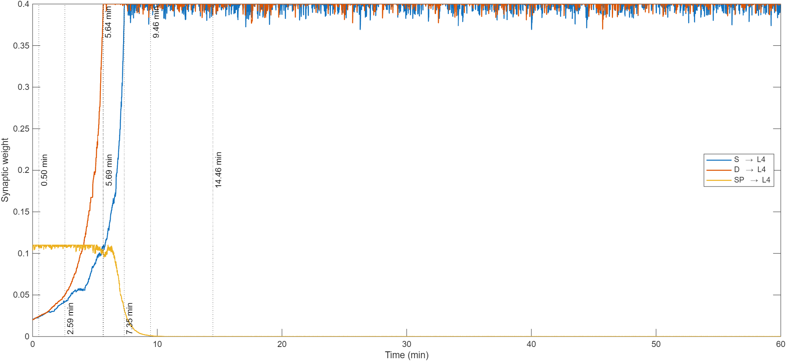
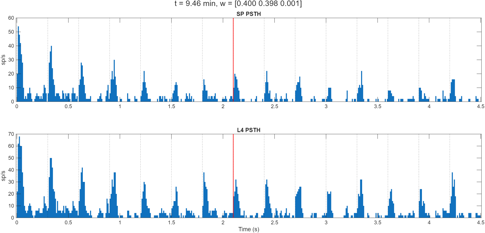

# Project IV: An Adaptive Thalamus–Subplate–Layer 4 Network (Depressing Synapses and STDP)

Course project for Computational Neuroscience (EC60007), IIT Kharagpur, Autumn 2026. Implemented in MATLAB.

The project simulates a small spiking network in which two thalamic inputs, a **standard (S)** and a **deviant (D)** stimulus channel, drive a single **subplate (SP)** neuron and a single **layer 4 (L4)** neuron, and SP also projects to L4. All five synapses are short-term depressing, and the three synapses onto L4 are also plastic through spike-timing-dependent plasticity (STDP). The questions are how the network responds to an oddball stimulus stream, and how its synaptic weights develop over an hour of stimulation.


## What is in this folder

```
project-4-adaptive-network/
├── src/project4_adaptive_network.m   # single script, produces every figure
└── results/Figure_1.png ... Figure_16.png (Figures 9 and 10 are not used)
```

Run `src/project4_adaptive_network.m` in MATLAB. Each question is a `%%` section. The two 60-minute runs (Q4 and Q5) simulate 3.6 million 1 ms steps each, in chunks of 100 stimuli, and write large `.mat` files (`q4_results.mat`, `q5_results.mat` and state files) next to the script. The Q4 section that follows (the `verNOp` runs) loads `q4_results.mat`. Those files are excluded from the repository by `.gitignore`.

## Model

**Synapses (depressing).** Each synapse has a recovered, effective and inactive fraction `xr, xe, xi`:

```
dxr/dt = −M·xr/τre + xi/τir
dxe/dt = +M·xr/τre − xe/τei
dxi/dt = xe/τei − xi/τir
```

with `M` the presynaptic spike and `τre = 0.9 ms`, `τir = 5000 ms`, and `τei = 10 ms` for the thalamic synapses and `27 ms` for SP → L4. The effective fraction `xe` scales the synaptic weight. The equations are integrated with RK4 at 1 ms steps.

**Neurons (leaky integrate-and-fire with refractory drop).** The input to each neuron is `g(t)·w·xe` summed over its synapses, where `g(t)` is the presynaptic spike train convolved with an exponential kernel (`τsyn = 10 ms`) after a 1 ms synaptic delay. The voltage keeps 90% of its previous value at each step (the 10% leak). A spike occurs when the voltage crosses 0.05. A drop `5·exp(−t/2 ms)` is then subtracted from the voltage for 20 ms (absolute and relative refractory period). The refractory term is applied to the value compared with the threshold and is not stored in the integrated voltage.

**Weights.** Th → SP: 0.2 each, fixed. Th → L4: 0.02 each, range 0.0001–0.4. SP → L4: 0.11, range 0.0001–0.11. A weight at a limit cannot cross it but can move away from it.

**STDP on L4 synapses.** Multiplicative updates with `Δt = t_post − t_pre`:

```
Δw/w = +0.015·exp(−Δt/13 ms)    (Δt > 0, potentiation)
Δw/w = −0.021·exp( Δt/20 ms)    (Δt < 0, depression)
```

Pairs are counted all-to-all, using exponentially decaying spike traces so the cost per time step is constant.

**Input spike trains.** Inhomogeneous Poisson processes with rate vectors at 1 ms resolution. During stimulus S the S neuron fires at 10 sp/s and D at 2.5 sp/s (and the reverse for stimulus D); between stimuli both fire at 0.5 sp/s. Stimuli last 50 ms with a 250 ms gap.

## Code structure

| Function | Purpose |
| --- | --- |
| `generate_poisson` | Inhomogeneous Poisson spike train from a rate vector |
| `generate_rates` | Rate vectors for S and D from a stimulus sequence |
| `sp_neuron` | SP neuron, with its two thalamic depressing synapses |
| `l4_neuron` | L4 neuron, with three depressing synapses and STDP (switchable with a `plastic` flag) |
| `rk4` | One RK4 step of the synaptic depression equations |

`sp_neuron` and `l4_neuron` take an optional state structure (voltage, filtered inputs, depression variables, refractory tail, weights and STDP traces) and return the updated state, so a long run can be done in chunks with exactly the same result as a single run. `plastic = 0` gives the version without long-term plasticity (called `verNOp` in the handout).

## Questions and results

| Question | What the code does | Figures |
| --- | --- | --- |
| Q1 | Inhomogeneous Poisson generator for a random rate around 40–50 sp/s. PSTH from 10 to 320 repeats against the true rate, and the RMSE against the number of repetitions. The RMSE falls from about 60 sp/s at 10 repeats to about 11 sp/s at 320, as expected from `1/√n`. | 1–2 |
| Q2 | Oddball stream (14 S, one D as the 8th stimulus), 50 repeats, no plasticity: PSTHs of SP and L4 (10 ms bins). Both responses depress over the S stimuli, and the response to D is clearly larger than the S response just before it. | 3 |
| Q3 | The same protocol with `τir` = 1000, 3000 and 10000 ms. Shorter `τir` gives weaker adaptation and a less distinct D response; longer `τir` gives strong adaptation, especially in L4. | 4–6 |
| Q4 | 60 minutes of stimulation with S and D at probabilities 0.9 and 0.1, with plasticity. The weights are tracked over time, and `verNOp` is run at time points that the script detects from the weight curves (start, first rise of the thalamic weights, start of the SP → L4 decline, saturation of D → L4 and of S → L4, SP → L4 reaching its floor, and 5 minutes after that) and marks on the weight figure. | 7, 11–16 |
| Q5 | The same 60 minutes with S and D equally likely. | 8 |

### Weight development (Q4)



- SP → L4 starts at its upper limit (0.11) and ends at its lower limit, while both thalamic synapses on L4 grow until they reach 0.4. A likely reason for the pruning of SP → L4 is that, once the thalamic synapses are strong, L4 tends to fire before SP does, so STDP depresses the SP synapse.
- The time points, and the weights used at each of them, are printed in the title of each `verNOp` figure. Which of S → L4 and D → L4 leads depends on the random stimulus sequence of the run.

### Oddball responses after learning (Q4)



At the last time point (SP → L4 at its floor, thalamic weights saturated) L4 is driven directly by the thalamic inputs. Its responses to S stay at about 30 to 50 sp/s across the stream, instead of decaying to about 10 sp/s as in the initial network (Figure 3), and the response to the deviant no longer stands out. Figures 11 to 15 show the intermediate stages.

### Equal stimulus probabilities (Q5)


When S and D are equally likely, the two thalamic synapses on L4 follow similar trajectories and saturate together, while SP → L4 is again pruned.

## Figure index

| Figure | Content |
| --- | --- |
| 1 | PSTH estimation error versus number of repeats |
| 2 | PSTH from 320 repeats against the true rate λ(t) |
| 3 | Oddball PSTHs of SP and L4 (initial weights, τir = 5000 ms) |
| 4, 5, 6 | Oddball PSTHs for τir = 1000, 3000 and 10000 ms |
| 7 | Synaptic weights over 60 minutes, p(D) = 0.1 |
| 8 | Synaptic weights over 60 minutes, p(D) = 0.5 |
| 11 onwards | Oddball PSTHs (no plasticity) with the weights frozen at the detected time points of the Q4 run, one figure per time point |

## Notes

- Results depend on the random spike trains and stimulus sequence, so the exact timings of the weight changes differ from run to run.
- The assignment handout is not part of this repository.
